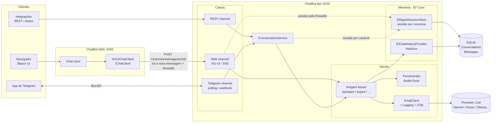
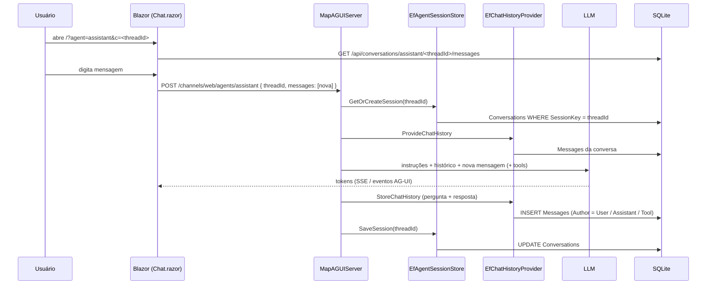
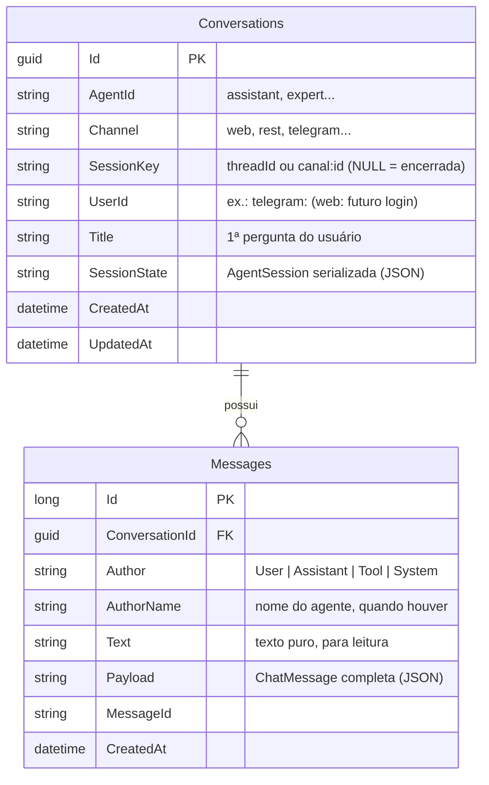
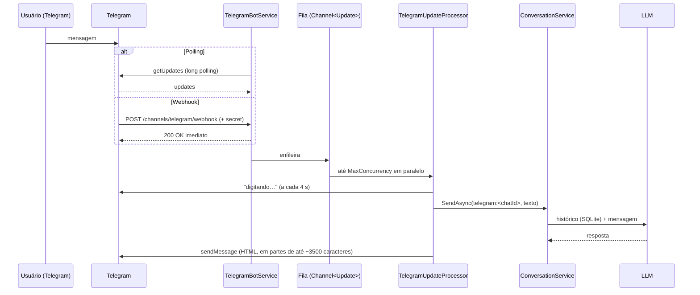

# 💬 ChatBot — .NET 10 + Microsoft Agent Framework

Chatbot web para conversar com modelos de linguagem (LLMs), construído com o stack de IA atual da Microsoft
e com um backend **multicanal**: atende o chat web (Blazor), o **Telegram** e uma API REST — todos usando os
**mesmos agentes** e a mesma memória. Outros canais (WhatsApp, Teams...) seguem o mesmo padrão.

> ℹ️ Baseado nas APIs da release
> [`dotnet-1.25.0`](https://github.com/microsoft/agent-framework/releases/tag/dotnet-1.25.0) do Microsoft Agent Framework.

---

## Sumário

1. [Tecnologias](#-tecnologias)
2. [Arquitetura](#-arquitetura)
3. [Estrutura de pastas](#-estrutura-de-pastas)
4. [Pré-requisitos](#-pré-requisitos)
5. [Configuração](#-configuração)
6. [Executando](#-executando)
7. [Endpoints do backend](#-endpoints-do-backend)
8. [Como funciona por dentro](#-como-funciona-por-dentro)
9. [Customizando](#-customizando)
10. [Canal Telegram](#-canal-telegram)
11. [Adicionando outro canal](#-adicionando-outro-canal)
12. [Observabilidade](#-observabilidade)
13. [Segurança e produção](#-segurança-e-produção)
14. [Solução de problemas](#-solução-de-problemas)
15. [Roadmap](#-roadmap)

---

## 🧰 Tecnologias

| Camada | Tecnologia | Por quê |
|---|---|---|
| Runtime | **.NET 10** / C# 14 | Versão LTS atual |
| Agentes | **[Microsoft Agent Framework](https://learn.microsoft.com/agent-framework/overview/) 1.25** (`Microsoft.Agents.AI`) | Sucessor oficial de Semantic Kernel + AutoGen (GA em abril/2026). Agentes, ferramentas, sessões, workflows, MCP |
| Hosting de agentes | `Microsoft.Agents.AI.Hosting` *(preview)* | Registra agentes no DI do ASP.NET Core (`builder.AddAIAgent(...)`) |
| Abstração de LLM | **[Microsoft.Extensions.AI](https://learn.microsoft.com/dotnet/ai/microsoft-extensions-ai) 10.10** (`IChatClient`) | Interface única para qualquer provedor + middlewares (logging, OpenTelemetry, function calling) |
| Provedor | SDK `OpenAI` 2.14 + `Microsoft.Extensions.AI.OpenAI` | Funciona com OpenAI, Azure OpenAI / Microsoft Foundry, GitHub Models, Ollama... |
| Protocolo Web | **[AG-UI](https://docs.ag-ui.com/)** (`Microsoft.Agents.AI.Hosting.AGUI.AspNetCore` *(preview)* + `AGUI.Client` 1.0) | Protocolo aberto de eventos (SSE) entre agente e interface: texto em streaming, tool calls, estado |
| Telegram | **[Telegram.Bot](https://github.com/TelegramBots/Telegram.Bot) 22.10** | Cliente oficial da comunidade para a Bot API (polling e webhook) |
| Persistência | **EF Core 10 + SQLite** | Memória dos agentes (histórico), sessões e registro de todas as mensagens. Troca fácil para PostgreSQL/SQL Server |
| Frontend | **Blazor Web App** (Interactive Server) | UI em C#, streaming via SignalR |
| Build | `.slnx` + Central Package Management | Formato de solução novo e versões centralizadas em `Directory.Packages.props` |

---

## 🏛 Arquitetura

A ideia central: **agentes são registrados uma única vez**; cada canal é apenas um **adaptador** fino.



### Todos os canais funcionam igual

**O histórico fica sempre no servidor (SQLite).** O canal só envia a **nova mensagem** e um **identificador da conversa**:

| | Canal Web (AG-UI) | Canais de texto (REST, Telegram...) |
|---|---|---|
| Identificador da conversa | `threadId` (GUID gerado pelo navegador, fica na URL `?c=...`) | `canal:id` (ex.: `rest:demo-1`, `telegram:123456`) |
| Quem acha a sessão | `MapAGUIServer` → `EfAgentSessionStore` | `ConversationService` → `EfAgentSessionStore` |
| Quem carrega/grava o histórico | `EfChatHistoryProvider` (tabela `Messages`) | `EfChatHistoryProvider` (tabela `Messages`) |
| Resposta | Streaming de eventos AG-UI (texto, tool calls, erros) | Texto final (ou streaming via `SendStreamingAsync`) |

### Sessões: vários usuários / várias abas

Sim, cada usuário (e cada aba) tem a **sua própria conversa**:

- Cada aba do navegador é um *circuito* Blazor independente, com seu próprio estado em memória.
- Cada conversa tem um `threadId` próprio na URL (`/?agent=assistant&c=<threadId>`). Dois usuários abrindo a página
  recebem `threadId`s diferentes → **conversas e históricos separados** no banco.
- **F5 / reabrir a URL** recarrega a conversa a partir do banco. **"Nova conversa"** gera outro `threadId`;
  a anterior continua salva.
- ⚠️ Ainda **não há autenticação**: quem tiver a URL (o `threadId`) consegue continuar aquela conversa.
  Com login, o Agent Framework passa a isolar as sessões por usuário (veja [Segurança](#-segurança-e-produção)).

---

## 📁 Estrutura de pastas

```
ChatBot/
├─ ChatBot.slnx                       # solução (.NET 10, formato XML novo)
├─ Directory.Build.props              # net10.0, nullable, implicit usings para todos os projetos
├─ Directory.Packages.props           # versões de TODOS os pacotes NuGet
└─ src/
   ├─ ChatBot.Api/                    # ── BACKEND ──
   │  ├─ Program.cs                   # composição: banco + núcleo + canais
   │  ├─ appsettings.json             # connection string, provedor e lista de agentes
   │  ├─ ChatBot.Api.http             # requisições de exemplo
   │  ├─ Agents/                      # NÚCLEO (não sabe nada de canais)
   │  │  ├─ AIOptions.cs              # modelo da seção "AI" do appsettings
   │  │  ├─ ChatClientFactory.cs      # cria IChatClient (chave ou Entra ID) + logging + OpenTelemetry
   │  │  ├─ AgentRegistration.cs      # registra cada agente (AddAIAgent) + memória + session store
   │  │  └─ Tools/BuiltInTools.cs     # ferramentas (function calling) disponíveis aos agentes
   │  ├─ Data/                        # EF Core
   │  │  ├─ ChatBotDbContext.cs       # tabelas, índices e relacionamentos
   │  │  └─ Entities.cs               # Conversation, ConversationMessage, MessageAuthor
   │  ├─ Memory/                      # integração EF Core ⇄ Agent Framework
   │  │  ├─ EfChatHistoryProvider.cs  # ChatHistoryProvider: lê/grava a tabela Messages
   │  │  └─ EfAgentSessionStore.cs    # AgentSessionStore: guarda a AgentSession em Conversations
   │  ├─ Conversations/               # conversas independentes de canal
   │  │  ├─ ConversationKey.cs        # (Canal, ConversationId, AgentId, UserId)
   │  │  ├─ ConversationService.cs    # acha sessão → executa agente → salva sessão
   │  │  └─ ConversationEndpoints.cs  # GET de histórico / listagem de conversas
   │  └─ Channels/
   │     ├─ Web/WebChannelEndpoints.cs    # GET /api/agents + endpoints AG-UI por agente
   │     ├─ Rest/RestChannelEndpoints.cs  # POST/DELETE de conversas REST
   │     └─ Telegram/
   │        ├─ TelegramOptions.cs             # seção Channels:Telegram
   │        ├─ TelegramChannelExtensions.cs   # AddTelegramChannel / MapTelegramChannel (webhook)
   │        ├─ TelegramBotService.cs          # inicialização, polling e fila de processamento
   │        ├─ TelegramUpdateProcessor.cs     # comandos + pergunta ao agente + envio da resposta
   │        ├─ TelegramChatAgents.cs          # qual modelo cada chat usa (/modelo)
   │        └─ TelegramFormatter.cs           # Markdown → HTML do Telegram + divisão em 4096 chars
   └─ ChatBot.Web/                    # ── FRONTEND ──
      ├─ Program.cs                   # Blazor + HttpClient nomeado para a Api
      ├─ Services/ChatBotApiClient.cs # agentes, histórico salvo e AGUIChatClient por agente
      ├─ Components/
      │  ├─ App.razor, Routes.razor, _Imports.razor
      │  ├─ Layout/MainLayout.razor
      │  └─ Pages/
      │     ├─ Error.razor
      │     └─ Chat/
      │        ├─ Chat.razor          # página principal: conversa na URL, seletor de modelo, streaming, parar
      │        ├─ Chat.razor.js       # auto-scroll
      │        ├─ ChatMessageItem.razor
      │        ├─ ChatInput.razor     # caixa de texto + enviar/parar
      │        └─ ChatInput.razor.js  # Enter envia, Shift+Enter quebra linha, auto-resize
      └─ wwwroot/app.css              # estilos (tema claro/escuro automático)
```

---

## ✅ Pré-requisitos

- [.NET 10 SDK](https://dotnet.microsoft.com/download/dotnet/10.0)
- Acesso a pelo menos **um** provedor de LLM (veja a tabela abaixo)
- *(opcional)* Visual Studio 2026, VS Code com C# Dev Kit ou Rider

```bash
dotnet --version   # deve começar com 10.
```

---

## ⚙️ Configuração

Toda a configuração fica em `src/ChatBot.Api/appsettings.json`:

```jsonc
"ConnectionStrings": {
  "ChatBot": "Data Source=chatbot.db"         // arquivo SQLite criado na pasta da Api
},
"AI": {
  "Provider": {
    "Endpoint": "https://api.openai.com/v1", // qualquer endpoint compatível com OpenAI
    "ApiKey": "",                             // NUNCA commite a chave — use user-secrets
    "UseEntraId": false                       // true = DefaultAzureCredential (Azure)
  },
  "DefaultAgent": "assistant",                // agente usado quando o canal não informa um
  "MaxMessagesInContext": 50,                 // últimas N mensagens enviadas ao LLM (null = todas)
  "Agents": [
    {
      "Id": "assistant",                      // vira a rota /channels/web/agents/assistant
      "DisplayName": "Assistente (rápido)",   // texto no seletor do chat
      "Description": "Respostas rápidas para o dia a dia.",
      "Model": "gpt-5-mini",                  // nome do modelo (ou do deployment, no Azure)
      "Instructions": "Você é um assistente...", // system prompt
      "EnableTools": true                     // habilita as ferramentas de BuiltInTools
    }
  ]
}
```

> `MaxMessagesInContext` limita só o **contexto enviado ao modelo** (custo/tokens). Todas as mensagens
> continuam salvas no banco. O corte sempre começa numa mensagem do usuário, para não separar uma
> chamada de ferramenta do seu resultado.

### Banco de dados

- O arquivo `chatbot.db` (SQLite) é criado **automaticamente** na primeira execução (`EnsureCreated`).
- Ele está no `.gitignore`. Para "zerar" tudo, pare a Api e apague `chatbot.db*`.
- Para inspecionar: [DB Browser for SQLite](https://sqlitebrowser.org/), extensão *SQLite Viewer* do VS Code ou
  `sqlite3 src/ChatBot.Api/chatbot.db`.

### Guardando a chave com segurança (desenvolvimento)

```bash
cd src/ChatBot.Api
dotnet user-secrets set "AI:Provider:ApiKey" "<sua-chave>"
```

Em produção use variáveis de ambiente (`AI__Provider__ApiKey`), Azure Key Vault ou Managed Identity.

Outras opções do provedor: `AI:Provider:TimeoutSeconds` (padrão `300`) é o tempo máximo de cada chamada ao LLM —
o SDK usa 100 s por padrão, pouco para modelos gratuitos/de raciocínio.

A configuração do Telegram (`Channels:Telegram`) está na seção [Canal Telegram](#-canal-telegram).

### Provedores suportados

| Provedor | `Endpoint` | Autenticação | Observação |
|---|---|---|---|
| **OpenAI** | `https://api.openai.com/v1` | `ApiKey` | `Model` = ex. `gpt-5-mini` |
| **Azure OpenAI / Microsoft Foundry** | `https://<recurso>.openai.azure.com/openai/v1/` | `ApiKey` **ou** `UseEntraId: true` | `Model` = **nome do deployment**. Com Entra ID, faça `az login` e dê ao usuário o papel *Cognitive Services OpenAI User* |
| **GitHub Models** | `https://models.github.ai/inference` | `ApiKey` = GitHub PAT (escopo `models`) | `Model` = ex. `openai/gpt-5-mini` |
| **Ollama** (local) | `http://localhost:11434/v1` | `ApiKey` = qualquer valor | `Model` = ex. `llama3.2`; tool calling depende do modelo |
| **LM Studio** (local) | `http://localhost:1234/v1` | `ApiKey` = qualquer valor | |

Exemplo usando Ollama local:

```bash
dotnet user-secrets set "AI:Provider:Endpoint" "http://localhost:11434/v1"
dotnet user-secrets set "AI:Provider:ApiKey" "ollama"
dotnet user-secrets set "AI:Agents:0:Model" "llama3.2"
```

### Frontend

`src/ChatBot.Web/appsettings.json`:

```json
"ChatBotApi": { "BaseUrl": "http://localhost:5100" }
```

---

## ▶️ Executando

Em dois terminais, a partir da raiz do repositório:

```bash
# Terminal 1 — backend (http://localhost:5100)
dotnet run --project src/ChatBot.Api

# Terminal 2 — frontend (http://localhost:5000)
dotnet run --project src/ChatBot.Web
```

Abra **http://localhost:5000**, escolha o modelo no canto superior direito e converse.
A URL vira algo como `http://localhost:5000/?agent=assistant&c=4f9c...`: esse é o link da conversa.
Abra outra aba (ou outro navegador) e você terá outra conversa, independente.

Testes rápidos do backend (sem frontend):

```bash
curl http://localhost:5100/health
curl http://localhost:5100/api/agents

curl -X POST http://localhost:5100/channels/rest/conversations/demo-1/messages \
  -H "Content-Type: application/json" \
  -d '{"text":"Olá! Que horas são em São Paulo?","agentId":"assistant"}'
```

Ou abra `src/ChatBot.Api/ChatBot.Api.http` no Visual Studio / VS Code (extensão REST Client) / Rider.

---

## 🔌 Endpoints do backend

| Método | Rota | Canal | Descrição |
|---|---|---|---|
| `GET` | `/health` | — | Health check |
| `GET` | `/api/agents` | Web | Lista os agentes configurados (`id`, `displayName`, `description`, `model`, `isDefault`) |
| `POST` | `/channels/web/agents/{id}` | Web | Endpoint **AG-UI**. Corpo: `RunAgentInput`; resposta: `text/event-stream` |
| `POST` | `/channels/rest/conversations/{conversationId}/messages` | REST | `{ "text": "...", "agentId": "assistant" }` → `{ "conversationId": "...", "reply": "..." }` |
| `DELETE` | `/channels/rest/conversations/{conversationId}/?agentId=...` | REST | Encerra a conversa (a próxima mensagem começa outra). **O histórico continua no banco** |
| `GET` | `/api/conversations/{agentId}/{sessionId}/messages` | Web | Mensagens (usuário/assistente) da conversa ativa. Web: `sessionId` = `threadId` |
| `GET` | `/api/conversations?channel=&take=` | — | **Só em Development**: últimas conversas de todos os canais |
| `GET` | `/api/conversations/{conversationId}` | — | **Só em Development**: todas as mensagens de uma conversa, incluindo ferramentas |
| `POST` | `/channels/telegram/webhook` | Telegram | Recebe updates do Telegram. **Só existe no modo Webhook**; exige o header `X-Telegram-Bot-Api-Secret-Token` |
| `GET` | `/openapi/v1.json` | — | Documento OpenAPI (apenas em Development) |

Exemplo (simplificado) de eventos AG-UI devolvidos pelo canal Web:

```
data: {"type":"RUN_STARTED","threadId":"thread_1","runId":"run_1"}
data: {"type":"TEXT_MESSAGE_START","messageId":"...","role":"assistant"}
data: {"type":"TEXT_MESSAGE_CONTENT","messageId":"...","delta":"Olá"}
data: {"type":"TEXT_MESSAGE_CONTENT","messageId":"...","delta":"! Tudo bem?"}
data: {"type":"TEXT_MESSAGE_END","messageId":"..."}
data: {"type":"RUN_FINISHED","threadId":"thread_1","runId":"run_1"}
```

---

## 🔍 Como funciona por dentro

### 1. Criação do agente (núcleo)

`AgentRegistration.AddChatAgents()` percorre `AI:Agents` e, para cada item:

```csharp
builder.AddAIAgent(definition.Id, (services, name) =>
{
    IChatClient chatClient = ChatClientFactory.Create(options.Provider, definition.Model, services);

    return chatClient.AsAIAgent(new ChatClientAgentOptions
    {
        Name = name,
        Description = definition.Description,
        ChatHistoryProvider = services.GetRequiredService<EfChatHistoryProvider>(), // memória no SQLite
        ChatOptions = new ChatOptions
        {
            Instructions = definition.Instructions,
            Tools = definition.EnableTools ? BuiltInTools.All() : null,
        },
    }, services: services);
})
.WithSessionStore((services, _) => services.GetRequiredService<EfAgentSessionStore>(), withIsolation: false);
```

- `AddAIAgent` registra um `AIAgent` **keyed** pelo `Id` no DI.
- `ChatHistoryProvider` diz ao agente **de onde vem e para onde vai o histórico** (em vez da memória RAM padrão).
- `WithSessionStore` diz ao hosting **onde guardar as sessões** — usado automaticamente pelo `MapAGUIServer`.
- `ChatClientFactory` monta o pipeline do `IChatClient`: `OpenAI ChatClient → AsIChatClient() → UseLogging() → UseOpenTelemetry()`.
- O `ChatClientAgent` adiciona automaticamente a **invocação de funções** (quando o modelo pede uma ferramenta,
  o framework executa o método C# e devolve o resultado ao modelo).

### 2. Canal Web (AG-UI)



- `WebChannelEndpoints.MapWebChannel()` chama `endpoints.MapAGUIServer(agent.Id, "/channels/web/agents/{id}")` para cada agente.
- No frontend, `ChatBotApiClient.CreateChatClient(agentId)` devolve um `AGUIChatClient` — para o Blazor é um `IChatClient` comum.
- O Blazor manda o `threadId` (e o `runId` anterior como `parentRunId`, como o protocolo AG-UI define) via
  `ChatOptions.RawRepresentationFactory = _ => new RunAgentInput { ThreadId = ..., ParentRunId = ... }`.
- As **instruções (system prompt) ficam no backend**; o frontend só envia a mensagem do usuário.

### 3. Canais de texto (`IConversationService`)

```csharp
var key = new ConversationKey("rest", conversationId, agentId);
string reply = await conversations.SendAsync(key, "texto do usuário");
```

Internamente, `ConversationService`:

1. Resolve o `AIAgent` keyed (ou o `DefaultAgent`).
2. Adquire um *lock* por conversa (mensagens seguidas do mesmo chat são processadas em ordem).
3. Busca a sessão no `EfAgentSessionStore` pela chave `"rest:<conversationId>"` (ou cria uma nova).
4. Executa `agent.RunStreamingAsync(mensagem, session)` — o `EfChatHistoryProvider` carrega e grava o histórico.
5. Salva a sessão (`SaveSessionAsync`).

`ResetAsync` **não apaga nada**: só desliga a sessão da chave (`SessionKey = NULL`). A próxima mensagem
cria uma conversa nova; a antiga continua consultável.

### 4. Banco de dados



- **`Messages` é ao mesmo tempo a memória do agente e o registro da conversa.** Tudo que o usuário envia
  (`Author = User`), tudo que o agente responde (`Assistant`) e as chamadas/resultados de ferramentas (`Tool`/`Assistant`)
  ficam salvos na ordem em que aconteceram.
- `Text` é para leitura humana e relatórios; `Payload` guarda a `ChatMessage` completa (inclui tool calls) e é o que
  volta para o LLM nos próximos turnos.
- `SessionState` guarda só o estado da sessão (ex.: `{ "EfChatHistoryProvider": { "conversationId": "..." } }`), não as mensagens.
- Índice único `(AgentId, SessionKey)`: no máximo uma conversa **ativa** por chave.

Consultas úteis:

```sql
-- Últimas conversas
SELECT Id, Channel, AgentId, Title, UpdatedAt FROM Conversations ORDER BY UpdatedAt DESC LIMIT 20;

-- Diálogo de uma conversa
SELECT Author, Text, CreatedAt FROM Messages
WHERE ConversationId = '<id>' AND Author IN ('User', 'Assistant') AND Text <> ''
ORDER BY Id;

-- Volume por canal
SELECT c.Channel, COUNT(*) AS Mensagens FROM Messages m
JOIN Conversations c ON c.Id = m.ConversationId GROUP BY c.Channel;
```

---

## 🛠 Customizando

### Adicionar um novo modelo/agente

Basta acrescentar um item em `AI:Agents` — ele aparece no seletor e ganha endpoint próprio, sem mudar código:

```json
{
  "Id": "tradutor",
  "DisplayName": "Tradutor PT ⇄ EN",
  "Model": "gpt-5-mini",
  "Instructions": "Traduza tudo que o usuário enviar entre português e inglês. Responda só com a tradução.",
  "EnableTools": false
}
```

### Adicionar uma ferramenta (function calling)

Em `src/ChatBot.Api/Agents/Tools/BuiltInTools.cs`:

```csharp
[Description("Consulta o status de um pedido pelo número.")]
public static async Task<string> GetOrderStatus(
    [Description("Número do pedido")] string orderId)
{
    // chame seu banco/API aqui
    return $"Pedido {orderId}: em transporte.";
}

public static IList<AITool> All() =>
[
    AIFunctionFactory.Create(GetCurrentDateTime, name: "get_current_datetime"),
    AIFunctionFactory.Create(GetOrderStatus,     name: "get_order_status"),
];
```

As descrições (`[Description]`) são enviadas ao modelo — escreva-as bem, é assim que ele decide quando usar a ferramenta.
Ferramentas que precisam de serviços do DI podem ser criadas dentro do delegate de `AddAIAgent` usando `services`.

### Trocar SQLite por PostgreSQL / SQL Server

Como tudo passa pelo EF Core, basta trocar o provider no `Program.cs` (e o pacote em `Directory.Packages.props`):

```csharp
// PostgreSQL: Npgsql.EntityFrameworkCore.PostgreSQL
options.UseNpgsql(builder.Configuration.GetConnectionString("ChatBot"));
// SQL Server: Microsoft.EntityFrameworkCore.SqlServer
options.UseSqlServer(builder.Configuration.GetConnectionString("ChatBot"));
```

### Migrations (quando o schema começar a mudar)

Hoje o banco é criado com `EnsureCreated()` — simples, mas **não altera um banco já existente**. Quando for
evoluir o modelo, passe para migrations:

```bash
dotnet tool install --global dotnet-ef
dotnet ef migrations add Inicial --project src/ChatBot.Api
```

E no `Program.cs` troque `EnsureCreatedAsync()` por `MigrateAsync()`.

### Limitar o contexto enviado ao LLM

`AI:MaxMessagesInContext` (padrão `50`) controla quantas mensagens recentes vão para o modelo em cada turno.
Para conversas muito longas, um próximo passo é resumir o histórico antigo (*chat reducer*) em vez de cortar.

### Outros provedores nativos

Se quiser usar um provedor fora do padrão OpenAI (ex.: Anthropic, Gemini), basta trocar a criação do
`IChatClient` em `ChatClientFactory` — o resto da aplicação só conhece `IChatClient`/`AIAgent`.
O Agent Framework também tem pacotes prontos (ex.: `Microsoft.Agents.AI.Anthropic`, `Microsoft.Agents.AI.Foundry`).

---

## 📨 Canal Telegram

O bot do Telegram usa **os mesmos agentes, a mesma memória e as mesmas tabelas** do chat web.
Cada chat do Telegram é uma conversa (`Channel = "telegram"`, `SessionKey = "telegram:<chatId>"`).

### 1. Criar o bot

1. No Telegram, abra o [@BotFather](https://t.me/BotFather) e envie `/newbot`.
2. Escolha um nome e um *username* terminado em `bot` (ex.: `MeuChatBot_bot`).
3. Copie o **token** (`123456789:AA...`). Ele é a senha do bot: não commite nem compartilhe.

### 2. Configurar

```bash
cd src/ChatBot.Api
dotnet user-secrets set "Channels:Telegram:Enabled" "true"
dotnet user-secrets set "Channels:Telegram:BotToken" "123456789:AA..."
```

Opções em `Channels:Telegram` (`appsettings.json`):

| Opção | Padrão | Descrição |
|---|---|---|
| `Enabled` | `false` | Liga o canal. Desligado, nada do Telegram é registrado |
| `BotToken` | — | Token do BotFather (**use user-secrets / variável de ambiente**) |
| `Mode` | `Polling` | `Polling`: a Api busca as mensagens (ideal em desenvolvimento, **não precisa de URL pública**). `Webhook`: o Telegram envia para a Api (produção) |
| `WebhookUrl` | — | Só no modo Webhook: URL **HTTPS pública** completa, ex. `https://meu-host/channels/telegram/webhook` |
| `SecretToken` | — | Só no modo Webhook (**obrigatório**): segredo que o Telegram envia em cada chamada. Só `A-Z a-z 0-9 _ -`, até 256 caracteres |
| `DefaultAgent` | `""` | Agente para chats novos. Vazio = `AI:DefaultAgent` |
| `AllowedUserIds` | `[]` | Ids de usuário do Telegram autorizados. Vazio = **qualquer pessoa** |
| `MaxConcurrency` | `8` | Quantos chats são atendidos em paralelo |
| `DropPendingUpdates` | `false` | `true` ignora as mensagens enviadas enquanto a Api estava parada |

> 💡 Recomendo preencher `AllowedUserIds` enquanto testa: o bot é público e cada mensagem gasta tokens do seu provedor.
> Para descobrir seu id, envie qualquer mensagem ao [@userinfobot](https://t.me/userinfobot).
> ```bash
> dotnet user-secrets set "Channels:Telegram:AllowedUserIds:0" "123456789"
> ```

### 3. Rodar (modo Polling)

```bash
dotnet run --project src/ChatBot.Api
```

No log deve aparecer `Telegram: bot @MeuChatBot_bot recebendo via polling.` Abra o bot no Telegram e envie `/start`.

### Comandos do bot

| Comando | O que faz |
|---|---|
| `/start` | Boas-vindas, modelo atual e ajuda |
| `/novo` | Encerra a conversa atual e começa outra. **O histórico continua no banco** |
| `/modelo` | Lista os agentes de `AI:Agents` (✅ = atual) |
| `/modelo <id>` | Troca o agente do chat (ex.: `/modelo expert`) |
| `/ajuda` | Lista os comandos |

Os comandos são registrados no menu do Telegram automaticamente na inicialização (`SetMyCommands`).

### Como funciona



- **Fila + processamento em segundo plano:** o webhook responde `200` na hora (o Telegram reenvia o update se
  demorar). Chats diferentes são atendidos em paralelo; mensagens do **mesmo** chat são processadas em ordem
  (lock no `ConversationService`).
- **Formatação:** os LLMs respondem em Markdown; o `TelegramFormatter` converte para o HTML aceito pelo Telegram
  (negrito, itálico, código, blocos de código, links, títulos e listas). Tabelas ficam como texto. Se o Telegram
  rejeitar o HTML, a mensagem é reenviada como texto puro.
- **Mensagens longas** são divididas (limite do Telegram: 4096 caracteres), preferindo quebras de parágrafo.
- **Grupos:** o bot só responde a comandos ou quando é mencionado (`@MeuChatBot_bot pergunta...`). A conversa é do
  grupo inteiro (um histórico por chat).
- **Usuário:** a coluna `Conversations.UserId` recebe `telegram:<id do usuário>`.
- **Escolha de modelo (`/modelo`):** guardada em memória. Depois de reiniciar a Api, o chat volta a usar o agente da
  sua conversa ativa mais recente (ou o padrão).
- **Só texto** por enquanto: fotos, áudios e figurinhas recebem um aviso.
- Se o token estiver errado ou o Telegram estiver fora do ar, o erro vai para o log e **só o canal Telegram é
  desativado** — o chat web continua funcionando.

### Modo Webhook (produção)

O Telegram precisa alcançar a Api por **HTTPS público** (portas 443, 80, 88 ou 8443).

```bash
dotnet user-secrets set "Channels:Telegram:Mode" "Webhook"
dotnet user-secrets set "Channels:Telegram:WebhookUrl" "https://meu-host/channels/telegram/webhook"
dotnet user-secrets set "Channels:Telegram:SecretToken" "um-segredo-longo-e-aleatorio_123"
```

Na inicialização a Api chama `setWebhook` sozinha. Para testar webhook na sua máquina, use um túnel
(ex.: `ngrok http 5100` ou *Dev Tunnels* do Visual Studio) e coloque a URL HTTPS do túnel em `WebhookUrl`.

Para voltar ao polling basta trocar `Mode` para `Polling`: o webhook é removido automaticamente
(o Telegram não permite os dois ao mesmo tempo).

> ⚠️ Só **uma** instância pode fazer polling com o mesmo token. Se rodar a Api em dois lugares (ex.: sua máquina e
> o servidor), use bots diferentes ou o modo Webhook.

Consulta útil:

```sql
-- Conversas do Telegram
SELECT Id, SessionKey, UserId, AgentId, Title, UpdatedAt FROM Conversations
WHERE Channel = 'telegram' ORDER BY UpdatedAt DESC;
```

---

## 🧩 Adicionando outro canal

O Telegram é o modelo a seguir (`src/ChatBot.Api/Channels/Telegram/`). Um canal novo (WhatsApp, Teams, Slack,
Discord, e-mail...) só precisa:

1. **Receber** a mensagem (webhook ou polling) e **responder rápido** ao provedor, processando em segundo plano.
2. Montar a chave e chamar o núcleo:
   ```csharp
   var key = new ConversationKey("whatsapp", numeroDoContato, agentId, UserId: $"whatsapp:{numeroDoContato}");
   string reply = await conversations.SendAsync(key, texto, ct);
   ```
3. **Enviar** a resposta no formato do canal (limites de tamanho, Markdown/HTML).
4. Registrar no `Program.cs` (`builder.AddXxxChannel()` / `app.MapXxxChannel()`).

Histórico, memória, troca de agente, ferramentas e o registro nas tabelas vêm prontos.

---

## 📈 Observabilidade

O pipeline do `IChatClient` já emite **logs** e **traces/métricas OpenTelemetry** (fonte `ChatBot.Api`, convenções
semânticas GenAI: modelo, tokens, duração). Para visualizar, adicione um exporter — por exemplo, o
[Aspire Dashboard](https://aspire.dev) standalone:

```bash
docker run --rm -it -p 18888:18888 -p 4317:18889 mcr.microsoft.com/dotnet/aspire-dashboard:latest
```

E no `Program.cs` da Api (pacotes `OpenTelemetry.Extensions.Hosting` + `OpenTelemetry.Exporter.OpenTelemetryProtocol`):

```csharp
builder.Services.AddOpenTelemetry()
    .WithTracing(t => t.AddSource("ChatBot.Api", "*Microsoft.Agents.AI*").AddOtlpExporter())
    .WithMetrics(m => m.AddMeter("ChatBot.Api", "*Microsoft.Agents.AI*").AddOtlpExporter());
```

`EnableSensitiveData` está `false` — prompts e respostas **não** vão para os traces.

---

## 🔐 Segurança e produção

Checklist antes de publicar:

- [ ] **Autenticação** nos endpoints: `MapAGUIServer(...).RequireAuthorization()` e no grupo REST.
- [ ] **Web → Api** autenticado (token de serviço ou mesmo provedor de identidade).
- [ ] **Isolar sessões por usuário.** Hoje qualquer pessoa com o `threadId` (a URL da conversa) consegue
      continuar e ler aquela conversa. Com autenticação, registre
      `builder.Services.AddHttpContextAccessor()` + `builder.Services.UseClaimsBasedAgentIsolation(...)`
      (pacote `Microsoft.Agents.AI.Hosting.AspNetCore`): o `MapAGUIServer` passa a prefixar a chave da sessão
      com uma partição do usuário (o `EfAgentSessionStore` grava como `<partição>=<valor>|<threadId>`). Nesse momento,
      ajuste o endpoint de histórico para montar a mesma chave e preencha/filtre a coluna `UserId`.
- [ ] **Telegram:** modo `Webhook` com `SecretToken` forte (o endpoint rejeita chamadas sem o header correto),
      token em Key Vault/variável de ambiente e, se o bot não for público, `AllowedUserIds` preenchido.
- [ ] Remover/proteger os endpoints de listagem (`/api/conversations`) — hoje só existem em Development.
- [ ] Banco gerenciado (PostgreSQL/SQL Server) com backup e política de retenção (as conversas podem conter dados pessoais — LGPD).
- [ ] **Segredos** fora do repositório (Key Vault / variáveis de ambiente / Managed Identity).
- [ ] **Rate limiting** (`builder.Services.AddRateLimiter`) para proteger custo de tokens.
- [ ] Revisar **ferramentas**: tudo que o modelo pode chamar deve ser seguro para qualquer usuário.
- [ ] HTTPS em ambos os projetos.
- [ ] O frontend renderiza respostas como **texto puro** (sem `MarkupString`) para evitar XSS. Se adicionar
      Markdown (ex.: Markdig), **sanitize** o HTML gerado.

---

## 🩺 Solução de problemas

| Sintoma | Causa provável / solução |
|---|---|
| `Configure AI:Provider:ApiKey ou AI:Provider:UseEntraId=true` | Chave não configurada → `dotnet user-secrets set "AI:Provider:ApiKey" ...` |
| Frontend mostra "Não foi possível conectar ao backend" | Api não está rodando em `ChatBotApi:BaseUrl` (padrão `http://localhost:5100`) |
| `401`/`403` no Azure | Com Entra ID: `az login` e papel *Cognitive Services OpenAI User*. Com chave: confira o endpoint `/openai/v1/` |
| `404 model not found` | `Model` deve ser o **nome do deployment** no Azure, ou um modelo disponível no provedor |
| Erro de restore de pacote `*-preview*` | Os pacotes de hosting do Agent Framework são preview — confira a versão em `Directory.Packages.props` no [NuGet](https://www.nuget.org/packages?q=Microsoft.Agents.AI) |
| Ferramentas não são chamadas (Ollama) | Use um modelo com suporte a *tool calling* (ex.: `llama3.1+`, `qwen2.5`) ou `"EnableTools": false` |
| `SQLite Error 1: 'no such table'` / `no such column` | O banco foi criado com um schema antigo e o `EnsureCreated` não altera bancos existentes → apague `chatbot.db*` (ou passe a usar migrations) |
| `database is locked` | Outro programa (ex.: DB Browser) está com o arquivo aberto em escrita — feche-o |
| O agente "esqueceu" a conversa | Verifique se a URL ainda tem o mesmo `c=<threadId>`; "Nova conversa" sempre gera outro |
| Erro do LLM sobre `tool` sem `tool_calls` | Histórico cortado no meio de uma chamada de ferramenta — aumente `MaxMessagesInContext` ou use `null` |
| Resposta em branco / aviso "o modelo terminou sem devolver texto" | Veja o *Warning* `LLM ... terminou SEM texto` no log. `finish_reason=length`: o modelo gastou o limite pensando — troque de modelo |
| `Channels:Telegram:BotToken não configurado` | Canal ligado sem token → `dotnet user-secrets set "Channels:Telegram:BotToken" ...` |
| Log `Telegram: falha ao inicializar o bot` | Token inválido (`401 Unauthorized`) ou sem acesso a `api.telegram.org`. O chat web continua funcionando |
| Telegram: `409 Conflict: terminated by other getUpdates request` | Outra instância está fazendo polling com o mesmo token — pare-a ou use outro bot |
| Telegram: bot não responde no modo Webhook | Confira `WebhookUrl` (HTTPS público, mesmo caminho `/channels/telegram/webhook`). Veja `https://api.telegram.org/bot<TOKEN>/getWebhookInfo` (campo `last_error_message`) |
| Telegram: bot não responde em grupo | Ele só responde a comandos ou menções (`@SeuBot ...`) |
| Telegram: "Você não tem permissão" | Seu id não está em `Channels:Telegram:AllowedUserIds` |

---

## 🗺 Roadmap

- [x] Histórico/memória persistidos com EF Core + SQLite (tabelas `Conversations` e `Messages`)
- [x] Conversa identificada na URL (várias abas/usuários, F5 mantém a conversa)
- [x] Canal **Telegram** (polling e webhook, comandos, troca de modelo por chat)
- [ ] Telegram: resposta em streaming (editar a mensagem enquanto o modelo escreve)
- [ ] Telegram: áudio (transcrição) e imagens
- [ ] Guardar a escolha de `/modelo` no banco
- [ ] Lista de conversas anteriores no frontend (depende de autenticação)
- [ ] Migrations do EF Core + PostgreSQL em produção
- [ ] Resumo automático de conversas longas (*chat reducer*)
- [ ] Renderização de **Markdown** sanitizado no chat
- [ ] Autenticação (Entra ID) no frontend e backend
- [ ] **Aspire AppHost** para orquestrar Api + Web + dashboard com um único `dotnet run`
- [ ] Ferramentas via **MCP** (Model Context Protocol)
- [ ] Upload de arquivos/imagens (conteúdo multimodal)
- [ ] Aprovação humana de ferramentas sensíveis (*human-in-the-loop* via AG-UI)
- [ ] Migrar para os componentes de IA do Blazor quando o .NET 11 for lançado
