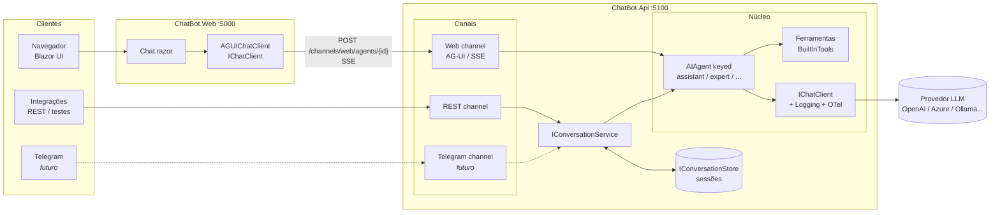

# 💬 ChatBot — .NET 10 + Microsoft Agent Framework

Chatbot web para conversar com modelos de linguagem (LLMs), construído com o stack de IA atual da Microsoft
e com um backend **multicanal**: hoje atende o chat web (Blazor) e uma API REST; amanhã Telegram, WhatsApp,
Teams etc. — todos usando os **mesmos agentes**.

> ⚠️ **Status:** versão inicial. O código foi escrito com base nas APIs da release
> [`dotnet-1.25.0`](https://github.com/microsoft/agent-framework/releases/tag/dotnet-1.25.0) do Microsoft Agent Framework,
> mas **ainda não foi compilado/executado** no ambiente em que foi gerado (sem SDK .NET 10 nem acesso ao NuGet).
> Rode `dotnet build` e abra uma issue se algo não compilar.

---

## Sumário

1. [Tecnologias](#-tecnologias)
2. [Arquitetura](#-arquitetura)
3. [Estrutura de pastas](#-estrutura-de-pastas)
4. [Pré-requisitos](#-pré-requisitos)
5. [Configuração](#-configuração)
6. [Executando](#-executando)
7. [Endpoints do backend](#-endpoints-do-backend)
8. [Como funciona por dentro](#-como-funciona-por-dentro)
9. [Customizando](#-customizando)
10. [Adicionando um novo canal (ex.: Telegram)](#-adicionando-um-novo-canal-ex-telegram)
11. [Observabilidade](#-observabilidade)
12. [Segurança e produção](#-segurança-e-produção)
13. [Solução de problemas](#-solução-de-problemas)
14. [Roadmap](#-roadmap)

---

## 🧰 Tecnologias

| Camada | Tecnologia | Por quê |
|---|---|---|
| Runtime | **.NET 10** / C# 14 | Versão LTS atual |
| Agentes | **[Microsoft Agent Framework](https://learn.microsoft.com/agent-framework/overview/) 1.25** (`Microsoft.Agents.AI`) | Sucessor oficial de Semantic Kernel + AutoGen (GA em abril/2026). Agentes, ferramentas, sessões, workflows, MCP |
| Hosting de agentes | `Microsoft.Agents.AI.Hosting` *(preview)* | Registra agentes no DI do ASP.NET Core (`builder.AddAIAgent(...)`) |
| Abstração de LLM | **[Microsoft.Extensions.AI](https://learn.microsoft.com/dotnet/ai/microsoft-extensions-ai) 10.10** (`IChatClient`) | Interface única para qualquer provedor + middlewares (logging, OpenTelemetry, function calling) |
| Provedor | SDK `OpenAI` 2.14 + `Microsoft.Extensions.AI.OpenAI` | Funciona com OpenAI, Azure OpenAI / Microsoft Foundry, GitHub Models, Ollama... |
| Protocolo Web | **[AG-UI](https://docs.ag-ui.com/)** (`Microsoft.Agents.AI.Hosting.AGUI.AspNetCore` *(preview)* + `AGUI.Client` 1.0) | Protocolo aberto de eventos (SSE) entre agente e interface: texto em streaming, tool calls, estado |
| Frontend | **Blazor Web App** (Interactive Server) | UI em C#, streaming via SignalR |
| Build | `.slnx` + Central Package Management | Formato de solução novo e versões centralizadas em `Directory.Packages.props` |

---

## 🏛 Arquitetura

A ideia central: **agentes são registrados uma única vez**; cada canal é apenas um **adaptador** fino.



### Dois modelos de conversa

| | Canal Web (AG-UI) | Canais de texto (REST, Telegram...) |
|---|---|---|
| Quem guarda o histórico | **O cliente** (Blazor envia o histórico a cada turno) | **O servidor** (`IConversationStore`) |
| Estado no servidor | Nenhum (stateless → escala horizontalmente) | `AgentSession` serializada por conversa |
| Resposta | Streaming de eventos (texto, tool calls, erros) | Texto final (ou streaming via `SendStreamingAsync`) |
| Por que | UIs ricas precisam de eventos granulares | Telegram/WhatsApp mandam só a nova mensagem + id do chat |

---

## 📁 Estrutura de pastas

```
ChatBot/
├─ ChatBot.slnx                       # solução (.NET 10, formato XML novo)
├─ Directory.Build.props              # net10.0, nullable, implicit usings para todos os projetos
├─ Directory.Packages.props           # versões de TODOS os pacotes NuGet
└─ src/
   ├─ ChatBot.Api/                    # ── BACKEND ──
   │  ├─ Program.cs                   # composição: núcleo + canais
   │  ├─ appsettings.json             # provedor e lista de agentes
   │  ├─ ChatBot.Api.http             # requisições de exemplo
   │  ├─ Agents/                      # NÚCLEO (não sabe nada de canais)
   │  │  ├─ AIOptions.cs              # modelo da seção "AI" do appsettings
   │  │  ├─ ChatClientFactory.cs      # cria IChatClient (chave ou Entra ID) + logging + OpenTelemetry
   │  │  ├─ AgentRegistration.cs      # registra cada agente com builder.AddAIAgent(...)
   │  │  └─ Tools/BuiltInTools.cs     # ferramentas (function calling) disponíveis aos agentes
   │  ├─ Conversations/               # conversas independentes de canal
   │  │  ├─ ConversationKey.cs        # (Canal, ConversationId, AgentId)
   │  │  ├─ ConversationService.cs    # carrega sessão → executa agente → salva sessão
   │  │  └─ IConversationStore.cs     # contrato + implementação em memória
   │  └─ Channels/
   │     ├─ Web/WebChannelEndpoints.cs    # GET /api/agents + endpoints AG-UI por agente
   │     ├─ Rest/RestChannelEndpoints.cs  # POST/DELETE de conversas REST
   │     └─ Telegram/README.md            # plano do canal Telegram
   └─ ChatBot.Web/                    # ── FRONTEND ──
      ├─ Program.cs                   # Blazor + HttpClient nomeado para a Api
      ├─ Services/ChatBotApiClient.cs # catálogo de agentes + cria AGUIChatClient por agente
      ├─ Components/
      │  ├─ App.razor, Routes.razor, _Imports.razor
      │  ├─ Layout/MainLayout.razor
      │  └─ Pages/
      │     ├─ Error.razor
      │     └─ Chat/
      │        ├─ Chat.razor          # página principal: seletor de modelo, streaming, parar, nova conversa
      │        ├─ Chat.razor.js       # auto-scroll
      │        ├─ ChatMessageItem.razor
      │        ├─ ChatInput.razor     # caixa de texto + enviar/parar
      │        └─ ChatInput.razor.js  # Enter envia, Shift+Enter quebra linha, auto-resize
      └─ wwwroot/app.css              # estilos (tema claro/escuro automático)
```

---

## ✅ Pré-requisitos

- [.NET 10 SDK](https://dotnet.microsoft.com/download/dotnet/10.0)
- Acesso a pelo menos **um** provedor de LLM (veja a tabela abaixo)
- *(opcional)* Visual Studio 2026, VS Code com C# Dev Kit ou Rider

```bash
dotnet --version   # deve começar com 10.
```

---

## ⚙️ Configuração

Toda a configuração de IA fica na seção `AI` de `src/ChatBot.Api/appsettings.json`:

```jsonc
"AI": {
  "Provider": {
    "Endpoint": "https://api.openai.com/v1", // qualquer endpoint compatível com OpenAI
    "ApiKey": "",                             // NUNCA commite a chave — use user-secrets
    "UseEntraId": false                       // true = DefaultAzureCredential (Azure)
  },
  "DefaultAgent": "assistant",                // agente usado quando o canal não informa um
  "Agents": [
    {
      "Id": "assistant",                      // vira a rota /channels/web/agents/assistant
      "DisplayName": "Assistente (rápido)",   // texto no seletor do chat
      "Description": "Respostas rápidas para o dia a dia.",
      "Model": "gpt-5-mini",                  // nome do modelo (ou do deployment, no Azure)
      "Instructions": "Você é um assistente...", // system prompt
      "EnableTools": true                     // habilita as ferramentas de BuiltInTools
    }
  ]
}
```

### Guardando a chave com segurança (desenvolvimento)

```bash
cd src/ChatBot.Api
dotnet user-secrets set "AI:Provider:ApiKey" "<sua-chave>"
```

Em produção use variáveis de ambiente (`AI__Provider__ApiKey`), Azure Key Vault ou Managed Identity.

### Provedores suportados

| Provedor | `Endpoint` | Autenticação | Observação |
|---|---|---|---|
| **OpenAI** | `https://api.openai.com/v1` | `ApiKey` | `Model` = ex. `gpt-5-mini` |
| **Azure OpenAI / Microsoft Foundry** | `https://<recurso>.openai.azure.com/openai/v1/` | `ApiKey` **ou** `UseEntraId: true` | `Model` = **nome do deployment**. Com Entra ID, faça `az login` e dê ao usuário o papel *Cognitive Services OpenAI User* |
| **GitHub Models** | `https://models.github.ai/inference` | `ApiKey` = GitHub PAT (escopo `models`) | `Model` = ex. `openai/gpt-5-mini` |
| **Ollama** (local) | `http://localhost:11434/v1` | `ApiKey` = qualquer valor | `Model` = ex. `llama3.2`; tool calling depende do modelo |
| **LM Studio** (local) | `http://localhost:1234/v1` | `ApiKey` = qualquer valor | |

Exemplo usando Ollama local:

```bash
dotnet user-secrets set "AI:Provider:Endpoint" "http://localhost:11434/v1"
dotnet user-secrets set "AI:Provider:ApiKey" "ollama"
dotnet user-secrets set "AI:Agents:0:Model" "llama3.2"
```

### Frontend

`src/ChatBot.Web/appsettings.json`:

```json
"ChatBotApi": { "BaseUrl": "http://localhost:5100" }
```

---

## ▶️ Executando

Em dois terminais, a partir da raiz do repositório:

```bash
# Terminal 1 — backend (http://localhost:5100)
dotnet run --project src/ChatBot.Api

# Terminal 2 — frontend (http://localhost:5000)
dotnet run --project src/ChatBot.Web
```

Abra **http://localhost:5000**, escolha o modelo no canto superior direito e converse.

Testes rápidos do backend (sem frontend):

```bash
curl http://localhost:5100/health
curl http://localhost:5100/api/agents

curl -X POST http://localhost:5100/channels/rest/conversations/demo-1/messages \
  -H "Content-Type: application/json" \
  -d '{"text":"Olá! Que horas são em São Paulo?","agentId":"assistant"}'
```

Ou abra `src/ChatBot.Api/ChatBot.Api.http` no Visual Studio / VS Code (extensão REST Client) / Rider.

---

## 🔌 Endpoints do backend

| Método | Rota | Canal | Descrição |
|---|---|---|---|
| `GET` | `/health` | — | Health check |
| `GET` | `/api/agents` | Web | Lista os agentes configurados (`id`, `displayName`, `description`, `model`, `isDefault`) |
| `POST` | `/channels/web/agents/{id}` | Web | Endpoint **AG-UI**. Corpo: `RunAgentInput`; resposta: `text/event-stream` |
| `POST` | `/channels/rest/conversations/{conversationId}/messages` | REST | `{ "text": "...", "agentId": "assistant" }` → `{ "conversationId": "...", "reply": "..." }` |
| `DELETE` | `/channels/rest/conversations/{conversationId}/?agentId=...` | REST | Apaga o histórico da conversa |
| `GET` | `/openapi/v1.json` | — | Documento OpenAPI (apenas em Development) |

Exemplo (simplificado) de eventos AG-UI devolvidos pelo canal Web:

```
data: {"type":"RUN_STARTED","threadId":"thread_1","runId":"run_1"}
data: {"type":"TEXT_MESSAGE_START","messageId":"...","role":"assistant"}
data: {"type":"TEXT_MESSAGE_CONTENT","messageId":"...","delta":"Olá"}
data: {"type":"TEXT_MESSAGE_CONTENT","messageId":"...","delta":"! Tudo bem?"}
data: {"type":"TEXT_MESSAGE_END","messageId":"..."}
data: {"type":"RUN_FINISHED","threadId":"thread_1","runId":"run_1"}
```

---

## 🔍 Como funciona por dentro

### 1. Criação do agente (núcleo)

`AgentRegistration.AddChatAgents()` percorre `AI:Agents` e, para cada item:

```csharp
builder.AddAIAgent(definition.Id, (services, name) =>
{
    IChatClient chatClient = ChatClientFactory.Create(options.Provider, definition.Model, services);

    return chatClient.AsAIAgent(new ChatClientAgentOptions
    {
        Name = name,
        Description = definition.Description,
        ChatOptions = new ChatOptions
        {
            Instructions = definition.Instructions,
            Tools = definition.EnableTools ? BuiltInTools.All() : null,
        },
    }, services: services);
});
```

- `AddAIAgent` registra um `AIAgent` **keyed** pelo `Id` no DI.
- `ChatClientFactory` monta o pipeline do `IChatClient`: `OpenAI ChatClient → AsIChatClient() → UseLogging() → UseOpenTelemetry()`.
- O `ChatClientAgent` adiciona automaticamente a **invocação de funções** (quando o modelo pede uma ferramenta,
  o framework executa o método C# e devolve o resultado ao modelo).

### 2. Canal Web (AG-UI)

```
Blazor (Chat.razor)
  └─ AGUIChatClient.GetStreamingResponseAsync(histórico)
       └─ POST /channels/web/agents/{id}  (RunAgentInput JSON)
            └─ MapAGUIServer → AIAgent.RunStreamingAsync
                 └─ eventos SSE → ChatResponseUpdate → UI atualiza token a token
```

- `WebChannelEndpoints.MapWebChannel()` chama `endpoints.MapAGUIServer(agent.Id, "/channels/web/agents/{id}")` para cada agente.
- No frontend, `ChatBotApiClient.CreateChatClient(agentId)` devolve um `AGUIChatClient` — para o Blazor é um `IChatClient` comum.
- As **instruções (system prompt) ficam no backend**; o frontend só envia mensagens de usuário/assistente.

### 3. Canais de texto (`IConversationService`)

```csharp
var key = new ConversationKey("rest", conversationId, agentId);
string reply = await conversations.SendAsync(key, "texto do usuário");
```

Internamente, `ConversationService`:

1. Resolve o `AIAgent` keyed (ou o `DefaultAgent`).
2. Adquire um *lock* por conversa (mensagens seguidas do mesmo chat são processadas em ordem).
3. Carrega a sessão do `IConversationStore` → `agent.DeserializeSessionAsync(...)`, ou cria com `agent.CreateSessionAsync()`.
4. Executa `agent.RunStreamingAsync(mensagem, session)`.
5. Serializa com `agent.SerializeSessionAsync(session)` e salva no store.

---

## 🛠 Customizando

### Adicionar um novo modelo/agente

Basta acrescentar um item em `AI:Agents` — ele aparece no seletor e ganha endpoint próprio, sem mudar código:

```json
{
  "Id": "tradutor",
  "DisplayName": "Tradutor PT ⇄ EN",
  "Model": "gpt-5-mini",
  "Instructions": "Traduza tudo que o usuário enviar entre português e inglês. Responda só com a tradução.",
  "EnableTools": false
}
```

### Adicionar uma ferramenta (function calling)

Em `src/ChatBot.Api/Agents/Tools/BuiltInTools.cs`:

```csharp
[Description("Consulta o status de um pedido pelo número.")]
public static async Task<string> GetOrderStatus(
    [Description("Número do pedido")] string orderId)
{
    // chame seu banco/API aqui
    return $"Pedido {orderId}: em transporte.";
}

public static IList<AITool> All() =>
[
    AIFunctionFactory.Create(GetCurrentDateTime, name: "get_current_datetime"),
    AIFunctionFactory.Create(GetOrderStatus,     name: "get_order_status"),
];
```

As descrições (`[Description]`) são enviadas ao modelo — escreva-as bem, é assim que ele decide quando usar a ferramenta.
Ferramentas que precisam de serviços do DI podem ser criadas dentro do delegate de `AddAIAgent` usando `services`.

### Persistir conversas (sair do "em memória")

Implemente `IConversationStore` (ex.: Redis) e troque o registro no `Program.cs`:

```csharp
builder.Services.AddSingleton<IConversationStore, RedisConversationStore>();
```

O estado é um `JsonElement` — pode ser gravado como string/JSON em qualquer banco.

### Outros provedores nativos

Se quiser usar um provedor fora do padrão OpenAI (ex.: Anthropic, Gemini), basta trocar a criação do
`IChatClient` em `ChatClientFactory` — o resto da aplicação só conhece `IChatClient`/`AIAgent`.
O Agent Framework também tem pacotes prontos (ex.: `Microsoft.Agents.AI.Anthropic`, `Microsoft.Agents.AI.Foundry`).

---

## 📨 Adicionando um novo canal (ex.: Telegram)

O núcleo já está pronto; um canal novo é só um adaptador. Roteiro para o Telegram
(detalhes em [`src/ChatBot.Api/Channels/Telegram/README.md`](src/ChatBot.Api/Channels/Telegram/README.md)):

1. Adicionar o pacote `Telegram.Bot` em `Directory.Packages.props` e no `ChatBot.Api.csproj`.
2. Configuração:
   ```json
   "Channels": { "Telegram": { "BotToken": "", "SecretToken": "", "AgentId": "assistant" } }
   ```
3. Criar `Channels/Telegram/TelegramChannelEndpoints.cs`:
   ```csharp
   app.MapPost("/channels/telegram/webhook", async (Update update, HttpRequest req,
       ITelegramBotClient bot, IConversationService conversations, CancellationToken ct) =>
   {
       // 1. validar header X-Telegram-Bot-Api-Secret-Token
       if (update.Message is not { Text: { } text } msg) return Results.Ok();

       var key = new ConversationKey("telegram", msg.Chat.Id.ToString(), AgentId: "");

       if (text == "/novo")
       {
           await conversations.ResetAsync(key, ct);
           await bot.SendMessage(msg.Chat.Id, "Conversa reiniciada ✅", cancellationToken: ct);
           return Results.Ok();
       }

       var reply = await conversations.SendAsync(key, text, ct);
       await bot.SendMessage(msg.Chat.Id, reply, cancellationToken: ct);
       return Results.Ok();
   });
   ```
4. Registrar o webhook no Telegram apontando para `https://<seu-host>/channels/telegram/webhook`.
5. Trocar o `InMemoryConversationStore` por um store persistente.

> Dica: o Telegram reenvia o update se o webhook demorar. Para respostas longas, responda `200` rápido e
> processe em background (ex.: `Channel<T>` + `BackgroundService`).

O mesmo padrão serve para WhatsApp, Microsoft Teams (Microsoft 365 Agents SDK), Slack, Discord, e-mail etc.

---

## 📈 Observabilidade

O pipeline do `IChatClient` já emite **logs** e **traces/métricas OpenTelemetry** (fonte `ChatBot.Api`, convenções
semânticas GenAI: modelo, tokens, duração). Para visualizar, adicione um exporter — por exemplo, o
[Aspire Dashboard](https://aspire.dev) standalone:

```bash
docker run --rm -it -p 18888:18888 -p 4317:18889 mcr.microsoft.com/dotnet/aspire-dashboard:latest
```

E no `Program.cs` da Api (pacotes `OpenTelemetry.Extensions.Hosting` + `OpenTelemetry.Exporter.OpenTelemetryProtocol`):

```csharp
builder.Services.AddOpenTelemetry()
    .WithTracing(t => t.AddSource("ChatBot.Api", "*Microsoft.Agents.AI*").AddOtlpExporter())
    .WithMetrics(m => m.AddMeter("ChatBot.Api", "*Microsoft.Agents.AI*").AddOtlpExporter());
```

`EnableSensitiveData` está `false` — prompts e respostas **não** vão para os traces.

---

## 🔐 Segurança e produção

Checklist antes de publicar:

- [ ] **Autenticação** nos endpoints: `MapAGUIServer(...).RequireAuthorization()` e no grupo REST.
- [ ] **Web → Api** autenticado (token de serviço ou mesmo provedor de identidade).
- [ ] Se usar sessões no servidor com múltiplos usuários, isole por usuário
      (`builder.Services.UseClaimsBasedAgentIsolation(...)` do Agent Framework / chave do `ConversationKey`).
- [ ] **Store persistente** para `IConversationStore`.
- [ ] **Segredos** fora do repositório (Key Vault / variáveis de ambiente / Managed Identity).
- [ ] **Rate limiting** (`builder.Services.AddRateLimiter`) para proteger custo de tokens.
- [ ] Revisar **ferramentas**: tudo que o modelo pode chamar deve ser seguro para qualquer usuário.
- [ ] HTTPS em ambos os projetos.
- [ ] O frontend renderiza respostas como **texto puro** (sem `MarkupString`) para evitar XSS. Se adicionar
      Markdown (ex.: Markdig), **sanitize** o HTML gerado.

---

## 🩺 Solução de problemas

| Sintoma | Causa provável / solução |
|---|---|
| `Configure AI:Provider:ApiKey ou AI:Provider:UseEntraId=true` | Chave não configurada → `dotnet user-secrets set "AI:Provider:ApiKey" ...` |
| Frontend mostra "Não foi possível conectar ao backend" | Api não está rodando em `ChatBotApi:BaseUrl` (padrão `http://localhost:5100`) |
| `401`/`403` no Azure | Com Entra ID: `az login` e papel *Cognitive Services OpenAI User*. Com chave: confira o endpoint `/openai/v1/` |
| `404 model not found` | `Model` deve ser o **nome do deployment** no Azure, ou um modelo disponível no provedor |
| Erro de restore de pacote `*-preview*` | Os pacotes de hosting do Agent Framework são preview — confira a versão em `Directory.Packages.props` no [NuGet](https://www.nuget.org/packages?q=Microsoft.Agents.AI) |
| Ferramentas não são chamadas (Ollama) | Use um modelo com suporte a *tool calling* (ex.: `llama3.1+`, `qwen2.5`) ou `"EnableTools": false` |

---

## 🗺 Roadmap

- [ ] Canal **Telegram**
- [ ] Store persistente (Redis/PostgreSQL)
- [ ] Renderização de **Markdown** sanitizado no chat
- [ ] Autenticação (Entra ID) no frontend e backend
- [ ] **Aspire AppHost** para orquestrar Api + Web + dashboard com um único `dotnet run`
- [ ] Ferramentas via **MCP** (Model Context Protocol)
- [ ] Upload de arquivos/imagens (conteúdo multimodal)
- [ ] Aprovação humana de ferramentas sensíveis (*human-in-the-loop* via AG-UI)
- [ ] Migrar para os componentes de IA do Blazor quando o .NET 11 for lançado
