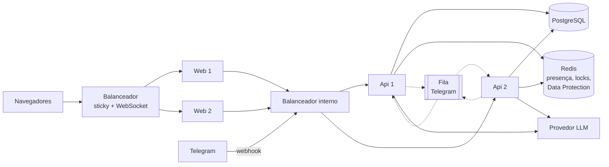

# TODO — Alta disponibilidade / escala horizontal

Objetivo: rodar **várias instâncias** do `ChatBot.Web` e do `ChatBot.Api` atrás de balanceadores.

A arquitetura já ajuda (agentes e canais desacoplados, histórico no banco, conversa identificada na URL),
mas algumas partes ainda ficam **em memória ou em arquivo local** — cada servidor teria a sua cópia.

## O que quebra hoje com N servidores

| Parte | Hoje | Problema com N servidores | Solução |
|---|---|---|---|
| **Banco** | SQLite (arquivo local) | Cada Api teria o seu banco | **PostgreSQL** ou **SQL Server** — só trocar o provider do EF Core |
| **Criação do banco** | `EnsureCreated` no startup | Várias instâncias criando ao mesmo tempo | **Migrations**, aplicadas uma vez no deploy (job/pipeline), não em cada instância |
| **Lock por conversa** (`ConversationService`) | `SemaphoreSlim` no processo | Duas mensagens da mesma conversa em servidores diferentes rodam juntas e embaralham o histórico | **Lock distribuído** (Redis ou *advisory lock* do Postgres). O dicionário de locks atual também cresce sem limite e precisa de limpeza |
| **Presença** (`WebPresenceTracker`) | Memória da Api | Cada Web avisa uma Api diferente (via balanceador); nenhuma tem a lista completa | **Redis** com expiração (o lado do Web já suporta várias instâncias) |
| **`/modelo` do Telegram** | Memória | A escolha vale só no servidor que recebeu o comando | Guardar no banco |
| **Telegram em polling** | Cada instância faz polling | O Telegram só aceita um polling por token (`409 Conflict`) | **Webhook**, ou um único *worker* dedicado ao Telegram |
| **Fila do Telegram** | `Channel<T>` em memória | Se o servidor cair, mensagens já confirmadas ao Telegram se perdem; ordem por chat não é garantida entre servidores | Fila durável (Azure Service Bus com sessões, RabbitMQ, Redis Streams) particionada por `chatId` |
| **Blazor Server** | Circuito SignalR preso ao servidor | O balanceador precisa mandar o mesmo navegador sempre para o mesmo servidor | **Sticky sessions** + WebSockets, ou **Azure SignalR Service** |
| **Data Protection do Web** | Chaves locais | Cookies/antiforgery gerados num servidor falham no outro | Chaves compartilhadas (Redis, Blob Storage ou banco) |
| **Conexões MCP** (`McpToolProvider`) | Uma conexão por servidor MCP em cada instância | Funciona, mas multiplica conexões/sessões nos servidores MCP | Aceitável; avaliar limites de conexão dos servidores MCP |

O Web já ajuda: a conversa fica na URL (`?c=<threadId>`) e o histórico no banco. Se um servidor do Web cair,
o navegador reconecta em outro e recarrega a conversa.

## Arquitetura alvo

- **Web**: sem estado próprio além do circuito (sticky sessions ou Azure SignalR resolvem).
- **Api**: totalmente sem estado — tudo no Postgres/Redis. Escala livre atrás do balanceador e pode ficar só na
  **rede interna** (resolve também o `PUT /api/presence/web` sem autenticação).
- **Telegram**: duas opções
  - mais simples: um *worker* único só para o Telegram (polling ou webhook), Apis escaláveis atendendo o web;
  - mais robusta: webhook + fila durável, qualquer instância processa.

## Ordem sugerida

- [ ] **1. PostgreSQL + migrations** — base de tudo; com isso já dá para ter várias Apis atendendo o web.
      Manter SQLite como opção para desenvolvimento.
- [ ] **2. Redis** — lock distribuído por conversa, presença e chaves de Data Protection.
- [ ] **3. Web** — sticky sessions (ou Azure SignalR) + Data Protection compartilhado.
- [ ] **4. Telegram** — worker único primeiro; fila durável só se o volume pedir. Guardar `/modelo` no banco.
- [ ] **5. Aspire AppHost** — sobe Postgres + Redis + Api + Web localmente com um `dotnet run` e ajuda no deploy
      (ex.: Azure Container Apps).
- [ ] **6. Observabilidade e rate limiting centralizados** — OpenTelemetry com coletor; limite de uso distribuído.

## Observação importante

Num chatbot o gargalo quase nunca é CPU — é **o provedor do LLM** (latência e limite de requisições).
Mais servidores não aumentam o limite do OpenRouter/OpenAI. Escalar horizontalmente serve para
**disponibilidade** (um servidor cair sem derrubar o serviço) e para muitas conexões simultâneas.
